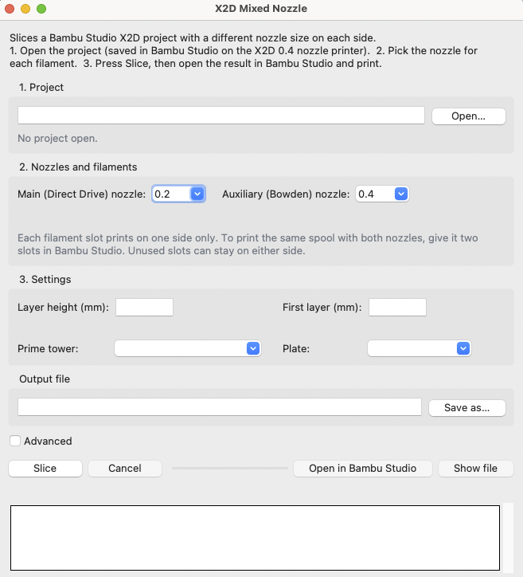

# X2D mixed nozzle sizes

Print one plate on a **Bambu Lab X2D** with a different nozzle size on each side, for example a 0.2 mm nozzle on Main for fine detail and a 0.4 mm nozzle on Auxiliary for everything else.

Bambu Studio only slices the X2D with the same nozzle size on both sides. It does have a mode for several nozzle sizes on one plate (built for the H3C), but doesn't offer it for the X2D. This script re-slices your normal Bambu Studio project in that mode with Bambu Studio's own command-line slicer. You then send the result from Bambu Studio as usual.

> **Unofficial and experimental. Use at your own risk.** Not made or supported by Bambu Lab. Tested with Bambu Studio 02.09.01.70 on macOS: the X2D accepted the job and showed 0.2 on Main and 0.4 on Auxiliary.

## Requirements

- Bambu Studio installed. The script finds it in the usual places; otherwise pass `--cli <path to BambuStudio or bambu-studio.exe>`.
- Python 3.9 or newer. For the window (below) it must include Tkinter: the installer from [python.org](https://www.python.org/downloads/) does. With Homebrew, also run `brew install python-tk`.
- The three scripts in one folder: `x2d_mixed_slice.py`, `flatten.py`, `fix_plate_diameters.py`. For the window, also `x2d_mixed_gui.py` and the launcher for your system.

## The window (easiest)

Double-click **`X2D Mixed Nozzle.command`** (macOS) or **`X2D Mixed Nozzle.bat`** (Windows), or run `python3 x2d_mixed_gui.py`.



1. **Open…** your project, saved in Bambu Studio as described in step 1 below.
2. Choose the nozzle on **Main** and **Auxiliary**, then for each filament whether it prints with Main or Auxiliary.
3. Adjust the layer height, first layer, prime tower or plate if needed, and press **Slice**.
4. When it says **Done**, press **Open in Bambu Studio** and print as in step 3 below. If it says **Do not print this file**, the log underneath says why.

The window runs the same script as the command line below, with the same checks.

On macOS, a launcher downloaded from the internet may be blocked the first time: right-click it, choose **Open**, then **Open** again. If it says it can't be opened because it isn't executable, run `chmod +x "X2D Mixed Nozzle.command"` once in Terminal.

## How to use (command line)

1. **Prepare the project in Bambu Studio** on the printer preset **Bambu Lab X2D 0.4 nozzle**. A project made on another X2D nozzle preset is switched over automatically, but its process changes are lost. Assign filaments as usual:
   - a filament per object or part, or painted regions;
   - a colour change on the layer slider (converted automatically, see below);
   - **Sparse infill filament** or **Support** filaments.

   Each filament slot prints with one nozzle size only, so the same spool on both sizes needs two slots. Save the project. A project saved by an older Bambu Studio should be opened and saved again in the current one.

2. **Run the script** with one nozzle size per filament slot, in slot order:

   ```
   python3 x2d_mixed_slice.py MyModel.3mf --filaments 0.4,0.2 --main 0.2 --aux 0.4
   ```

   On Windows use `py` or `python` instead of `python3`.

   | Option | Meaning |
   |---|---|
   | `--filaments` | nozzle size for each filament slot, in slot order (required) |
   | `--main`, `--aux` | nozzle on Main (Direct Drive) and Auxiliary (Bowden). Default 0.2 and 0.4 |
   | `--layer-height H` | project layer height. The 0.2 prints half of it: `0.16` gives 0.08 mm on the 0.2 and 0.16 mm on the 0.4 |
   | `--first-layer H` | first layer height (default: the project's) |
   | `--prime-tower keep\|on\|off` | prime tower (default: as in the project) |
   | `--plate N` | slice only plate N |
   | `--out FILE` | output file (default: `<project>_X2D_Main0.2_Aux0.4.gcode.3mf` next to the project) |
   | `--cli`, `--profiles` | Bambu Studio executable and its `profiles/BBL` folder, if not found |

   The script prints which preset each filament uses, then checks the sliced file. If something is wrong it prints **"PROBLEMS - do not print this file"** and stops with an error.

3. **Print.** Open the `…_X2D_Main0.2_Aux0.4.gcode.3mf` in Bambu Studio with **File → Open Project**. It opens already sliced, without re-slicing. Press **Print**, and map each filament slot to a spool on the side of its nozzle. If Bambu Studio warns that the nozzles don't match the printer, press **Cancel** and check that the Device tab shows the right nozzle on each side.

## How it works

- **Mode.** The project is switched to Bambu Studio's multi-nozzle-size mode. Layers follow the 0.2 nozzle: it prints every layer, the 0.4 every second one, each with line widths for its own size (0.21 mm and 0.42 mm walls).
- **Filaments.** Each filament is reloaded from Bambu's system preset for its nozzle size, for example "Bambu PLA Basic @BBL X2D 0.2 nozzle".
- **Colour change on the layer slider.** The mode ignores these, so the script replaces each one with a height-range modifier: that filament from that height up.
- **First layer.** The mode changes the first layer height. The script measures the result and, if needed, slices once more so the first layer matches the project.
- **Sending.** The output contains no model, so Bambu Studio treats it as a sliced file and sends it without re-slicing. The script also fixes two Bambu Studio bugs in this mode: it would store the first filament's nozzle size for both sides, and Print would write it back again. So the printer is told the real sizes (for example 0.2 / 0.4) instead of 0.2 / 0.2. The G-code itself is not changed.
- **Check.** After slicing, every used filament is checked on every plate: right side, line width that fits its nozzle, layer height and first layer.

## Good to know

- **Filament presets.** Changes you made to a filament preset in the project are not kept (the script lists them). Carbon-fibre filaments have no 0.2 preset.
- **Speed.** The 0.2 is slow: count on two to three times the time for the parts it prints. Each nozzle change also costs time, more with the prime tower.
- **When it pays off.** Use the fine nozzle for part of the model only, such as a detailed top, a logo or small text. Splitting walls and infill between nozzles changes nozzle every layer. 0.4 walls with 0.6 infill is **not** faster on standard hotends, because both are limited to the same flow.
- **Prime tower.** Nozzle changes purge no filament here; the tower only re-primes the incoming nozzle. With few changes you can often turn it off with `--prime-tower off`. Watch the first line after each change.
- **Layer heights.** Both sides can't print at the same layer height: the 0.2 always prints half of the 0.4's layer height.

## License

MIT, see [LICENSE](LICENSE).
